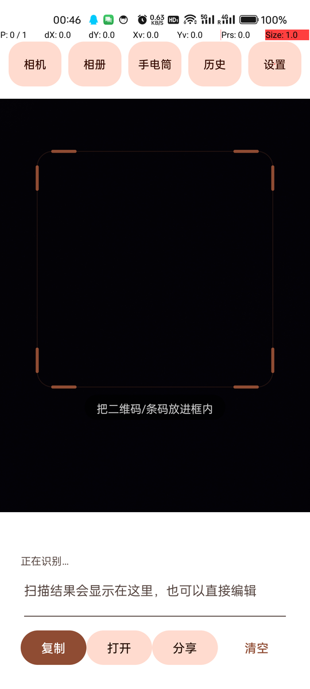
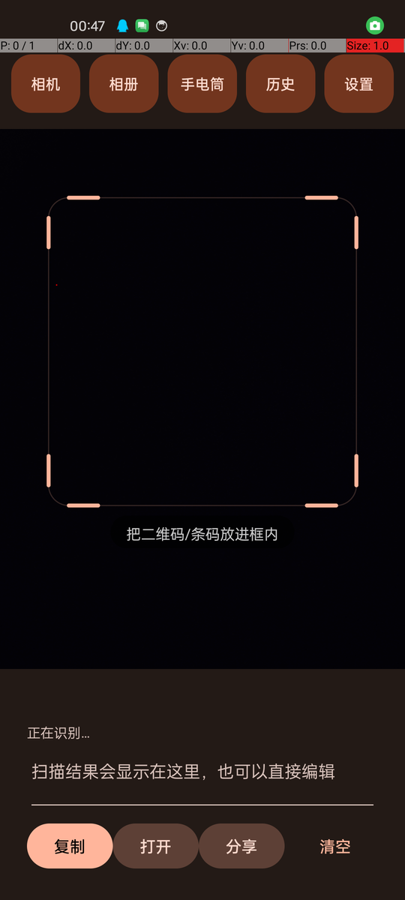
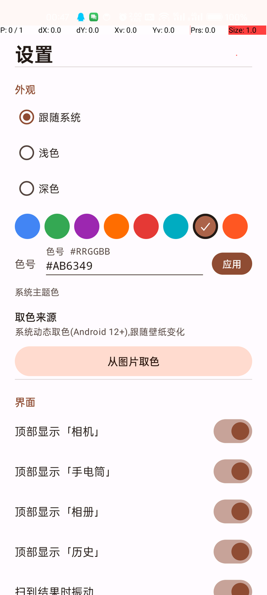

# PtFastScanQRcode

安卓上的二维码 / 条码扫描器:打开就是相机,对准即出结果。Camera2 + ZXing,界面用 Material 3,Android 12 以上走系统 Material You,更老的系统用同一套官方算法现算配色。

<p>


</p>

<p>



</p>

## 功能

| | |
|---|---|
| **实时识别** | 相机预览直接解码,支持 QR、Data Matrix、Aztec、PDF417 以及常见一维码;扫到网址会问要不要用浏览器打开 |
| **结果处理** | 结果可以直接改,一键复制 / 打开 / 分享 / 清空 |
| **其它入口** | 「相机」调系统相机拍一张再认、「相册」选本地图片解析、「历史」保存最近 50 条 |
| **对焦** | 取景框内自动对焦每秒一次,点画面手动对焦,手动后 6 秒交回自动;画面太糊时切微距模式兜底 |
| **主题** | 深浅模式(跟随系统 / 浅色 / 深色)+ 6 个预设色 + 「系统主题色」+ 任意色号 + 从图片取色 |
| **取色来源** | Android 12+ 用系统 MY 调色板;更低版本按 壁纸主色 → 壁纸图片量化 → 预设色 依次回退,并在设置里说明当前用的是哪条 |
| **界面** | 纯白取景底,顶部 5 个按钮(相机 / 相册 / 手电筒 / 历史 / 设置)可在设置里逐个隐藏 |
| **快捷启动** | 桌面长按图标的「扫一扫」、快捷设置磁贴、音量下键双击(无障碍,默认关) |
| **解码帧率** | 设置里 1 - 60 可调,默认 30,跟相机帧率对齐 |

## 安装

直接下 **`dist/PtFastScanQRcode.apk`**(约 1.6 MB),`minSdk 23`,Android 6.0 及以上。

> 仓库里的签名密钥 `app/signing/ptfastscan.jks` 只是为了让大家装得上同一个包,口令 `ptfastscan`。自己发布请换成自己的密钥。

## 构建

需要 JDK 17+ 和 Android SDK(platform 35、build-tools)。

```bash
git clone https://github.com/PAuPt6490/PtFastScanQRcode.git
cd PtFastScanQRcode
./gradlew assembleRelease
# 产物:app/build/outputs/apk/release/app-release.apk
```

Windows 上用 `gradlew.bat`。SDK 路径写进 `local.properties`(`sdk.dir=...`),或设 `ANDROID_HOME`。

## 技术要点

- **不用 Kotlin**:`android.builtInKotlin=false`,全 Java,省掉整个 kotlin-stdlib。
- **识别**:ZXing core。分三档——半分辨率全帧扫 QR(快)、全分辨率隔帧扫 QR、每 8 帧放开全部格式 + `TRY_HARDER`;实测稳定跑满相机帧率,fast 档约 6 ms/帧。
- **预览**:Camera2 取 1440×1080 预览流(和系统相机同档),等比缩放居中,不裁切放大,视野和原厂相机一致。
- **配色**:Material 1.12 的组件 + `Theme.Material3.*`。Android 12+ 靠 `DynamicColors` 读系统调色板;更低版本调用 Material 库自带的 MCU(`SchemeTonalSpot` + `MaterialDynamicColors`),也就是 Android 12 用的同一份实现 —— 不是自己近似出来的公式。
- **体积**:R8 + `shrinkResources`,资源只留一套密度,`packaging` 去掉 `META-INF` 等杂物。

## 已知限制

- 相机需要授权;没相机权限时只能走「相册」和「相机」拍图。
- 壁纸是视频动态壁纸时,系统可能给不出壁纸颜色,此时设置里会提示改用预设色或「从图片取色」。
- 桌面长按快捷方式依赖启动器的支持;音量下键双击要开无障碍服务。
- 只做了中文界面和竖屏。

<details>
<summary>目录结构</summary>

```
PtFastScanQRcode/
├─ app/
│  ├─ src/main/
│  │  ├─ java/com/ptfast/scanqr/
│  │  │  ├─ MainActivity.java     相机预览、解码循环、结果处理
│  │  │  ├─ SettingsActivity.java 设置界面(代码搭建,无 XML 布局)
│  │  │  ├─ M3.java               Material 3 / You 调色板
│  │  │  ├─ M3Ui.java             按钮、卡片、开关的 M3 外观
│  │  │  ├─ ColorSeed.java        壁纸 → 种子色(三级回退)
│  │  │  ├─ ThemeUtil.java        主题与预设色
│  │  │  ├─ Prefs.java            设置存储
│  │  │  ├─ QrDecoder.java        ZXing 三档解码
│  │  │  ├─ ScanOverlay.java      取景框、对焦圈
│  │  │  ├─ HistoryStore.java     历史记录
│  │  │  ├─ ScanTileService.java  快捷设置磁贴
│  │  │  └─ QuickLaunchService.java 音量键双击
│  │  ├─ res/                     布局、字符串、图标
│  │  └─ AndroidManifest.xml
│  └─ build.gradle.kts
├─ dist/PtFastScanQRcode.apk     已构建的安装包
├─ docs/                         README 截图
└─ LICENSE
```

</details>

## 许可证

[MIT](LICENSE)
